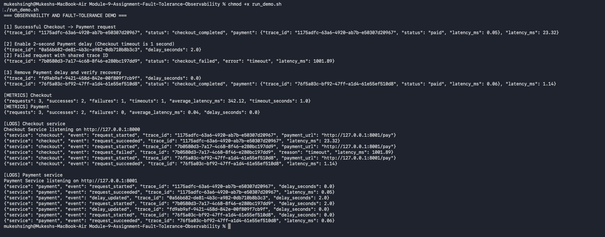

# Fault Tolerance and Observability Lab

This project simulates a distributed checkout flow with two Python services. The Checkout Service calls the Payment Service over HTTP. Both services emit structured request logs, latency measurements, success/failure counters, and the same `trace_id` so one request can be followed across the service boundary.

## Architecture

```text
Client
  |
  | POST /checkout + X-Trace-ID
  v
Checkout Service :8000
  |  timeout: 1 second
  | POST /pay + same X-Trace-ID
  v
Payment Service :8001
  |
  +-- /metrics       request counts and latency
  +-- /admin/delay   test-only delay control
```

## Run both services

Requirements: Python 3.9 or newer. No third-party packages are required.

Run the complete demonstration, including success, timeout failure, recovery, metrics, and logs:

```bash
chmod +x run_demo.sh
./run_demo.sh
```

Or run the services separately in two terminals:

```bash
python3 payment_service.py
python3 checkout_service.py
```

Then call Checkout:

```bash
curl -X POST http://127.0.0.1:8000/checkout \
  -H 'Content-Type: application/json' \
  -d '{"order_id":"order-1","amount":42.50}'
```

View metrics at `http://127.0.0.1:8000/metrics` and `http://127.0.0.1:8001/metrics`.

## Failure test

The Checkout timeout is one second. Enable a two-second delay in Payment:

```bash
curl -X POST http://127.0.0.1:8001/admin/delay \
  -H 'Content-Type: application/json' \
  -d '{"seconds":2}'
```

Then call Checkout again. Checkout returns HTTP `504` with `"error":"timeout"`, while both services remain running. The Checkout and Payment logs contain the same `trace_id`, allowing the delayed request to be followed across both services.

Remove the delay to verify recovery:

```bash
curl -X POST http://127.0.0.1:8001/admin/delay \
  -H 'Content-Type: application/json' \
  -d '{"seconds":0}'
curl -X POST http://127.0.0.1:8000/checkout \
  -H 'Content-Type: application/json' \
  -d '{"order_id":"order-recovered","amount":17.25}'
```

## Evidence to add after local execution

Run `./run_demo.sh` and capture the terminal output. The screenshot or pasted output should show:

1. A successful Checkout -> Payment response.
2. A timeout response with HTTP 504 and a shared trace ID in the logs.
3. A successful recovery response after the delay is set back to zero.
4. Checkout and Payment metrics showing requests, successes, failures, timeout count, and latency.

The local run evidence is attached below:



## Reflection

Logs explain what each service did and provide the shared trace ID needed to follow one request across service boundaries. Traces connect those events into a request path, making it easier to locate the service or operation where time was spent or failure occurred. Metrics summarize latency, success rate, and timeout counts so changes in system health can be detected quickly. Together, they show both the local error and its impact on the overall distributed request.
